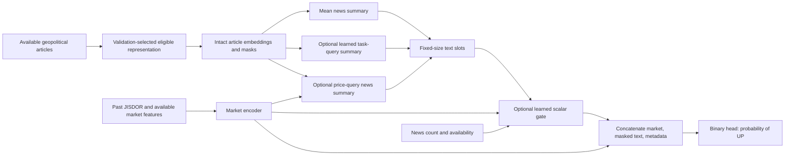

# Adapting multimodal attention to geopolitical news and binary USD/IDR classification

Review date: 10 November 2026. Project decision: **binary UP/DOWN classification of USD/IDR using geopolitical news**.

Recommendation: use the paper to motivate a controlled comparison of text–price fusion methods. Build a smaller, availability-aware model around JISDOR and geopolitical content, then test whether the language actually adds information. Performance improvements are hypotheses to evaluate, not established results for this dataset.

## 1. Paper evidence and access limits

Dakalbab, Kumar, Abu Talib, and Nasir (2025), *Advancing Forex prediction through multimodal text-driven model and attention mechanisms*, Intelligent Systems with Applications 26, 200518. [Publisher](https://www.sciencedirect.com/science/article/pii/S2667305325000444); [DOI](https://doi.org/10.1016/j.iswa.2025.200518).

Publisher sections 4.1–4.6 describe hourly OHLCV, major currency pairs, UP/HOLD/DOWN labels, FinBERT-based summarization, Twitter-RoBERTa sentiment with five-to-three mapping, TF-IDF, and dense modality encoders. Four fusion variants are compared: no attention, self-attention, bidirectional cross-attention, and their combination. Alignment includes preceding-price matching, sentiment carry-forward, and same-day summation. Evaluation describes 70/30 splitting and five-fold CV. Table 13 reports combined-model accuracies of 0.829, 0.852, and 0.834 across its three result columns. Data is available on request. These are paper results, not a benchmark for our task. [Source: methodology and results](https://doi.org/10.1016/j.iswa.2025.200518).

The review inspected publisher-indexed methods/results text. Direct full-page/PDF retrieval returned HTTP 403; author code, exact tensor shapes, checkpoints, and split indices were not independently verified. This is a methodological review and adaptation proposal, not a replication or a finding of proven leakage.

### Questions to resolve before a literal replication

The accessible description is not enough to settle these implementation questions. Treat them as checks to perform, not allegations of confirmed errors:

| Question | Required evidence |
|---|---|
| Which price change is the label, and when are its inputs available? | A timestamped example showing the feature interval, decision time, and later outcome interval. |
| Can a target-period return or closing price enter the input? | A feature whitelist and code proving every numeric feature ends at the decision cutoff. |
| Is validation forward-only? | Actual fold indices, order/shuffle settings, and purging of overlapping outcome intervals. |
| Is normalization fitted only on training data? | Separate fit/transform calls within each fold. |
| What does summarization actually do? | Exact checkpoint, sentence scores, selected spans, truncation, and selection budget. |
| What are the attention sequence axes? | Q/K/V shapes and the count of valid keys for each branch. |

For example, if a dataset labels the current price change and also supplies that exact return as a feature, the direction can be recovered without forecasting. Conversely, using the current observed return to predict the **next** return is legitimate when the current observation is already available. The distinction is the explicit shift and information cutoff, not the model's name.

## 2. What is worth adopting?

Our transferable research idea is **conditional fusion**: the interpretation of a news item can depend on the recent exchange-rate state, while the interpretation of that state can depend on available geopolitical information.

The useful experiment is therefore a progression:

```text
price alone
    → price + observed news availability
    → price + simple text aggregation
    → price + learned text–price interaction
```

Every step must use the same target, sample rows, chronological partitions, and comparable selection budget. Otherwise, an apparent gain might come from a different dataset or a larger tuning search rather than the architecture.

Separate two hypotheses:

- **Representation hypothesis:** contextual text representations are more informative than generic polarity scores.
- **Fusion hypothesis:** conditioning on price history improves the use of those representations beyond simple pooling and concatenation.

Testing both separately makes the NLP contribution assessable even when the most complex architecture does not win.

The current study uses three levels: text value, representation choice, and components on one validation-selected eligible representation. Within Level 3, distinguish **learned task-query pooling (T)**, **price-query cross-attention (C)**, and **learned fusion gating (G)**. The five main variants and three extensions are defined in [the authoritative three-level protocol](../rules/ablation_protocol.md). The combined model alone does not establish each component's contribution.

## 3. What must change for this project?

| Design decision | Proposed USD/IDR treatment | Why it matters |
|---|---|---|
| Market variable | One JISDOR observation per actual publication day | Preserves the meaning of the supplied exchange-rate series. |
| Output | Sign of the next nonzero adjacent-fixing return; two classes | Matches the user's fixed task. “Nonzero” masks a label; it does not skip calendar observations. |
| Content scope | Geopolitical relevance, actor/country, event type, and target-aware interpretation | Keeps the research about geopolitics rather than all financial news. |
| Information cutoff | Verified availability by the prediction decision | Prevents information from after the decision being presented as an input. |
| Missing news | Explicit count/mask and a price fallback | Separates missing collection from observed neutral language. |
| Aggregation | Mean baseline, then normalized learned or decay-weighted pooling | Avoids treating article volume as linguistic intensity. |
| Text representation | Frozen contextual embeddings first; sentiment probabilities as an auxiliary baseline | Preserves more information while limiting trainable parameters. |
| Validation | Expanding chronological development folds and a locked final test | Estimates generalization to later periods. |
| Added-value claim | Improvement over a price-plus-availability control | Tests language content beyond collection activity. |

OHLCV is not a prerequisite. JISDOR supports lagged returns, moving-average ratios, momentum, and historical volatility. Do not manufacture intraday highs/lows or calculate indicators requiring unavailable volume/high/low inputs. A separate OHLC source would be an optional additional modality with its own timestamps and definition.

## 4. Define the binary target before any model search

```text
r_next(t) = log(J_next / J_t)
UP   = 1 when J_next > J_t
DOWN = 0 when J_next < J_t
FLAT = unlabelled for the primary binary experiment
```

UP is a rise in **USD/IDR**, meaning rupiah depreciation against USD. It is not rupiah appreciation and is not a positive sentiment label.

Direct inspection of the current processed rate file gives:

| Diagnostic before feature warmup and further screening | Count |
|---|---:|
| JISDOR rows | 1,202 |
| Adjacent-fixing outcome pairs | 1,201 |
| UP | 665 |
| DOWN | 523 |
| Exact FLAT | 13 |
| Nonflat labelled pairs | 1,188 |

Keep all 1,202 observations when calculating rolling features and deciding which fixing is next. Mask the 13 FLAT labels afterward. Never delete flat fixings first and recompute adjacency: that would change the horizon. The last observation has no future label.

The full-sample UP share among nonflat pairs is approximately 55.98%. This describes imbalance; the baseline must use the majority class estimated from each training period, not the full dataset. Other exclusions and feature warmup will change the counts.

The calculated counts, equality pairs, and input hashes are recorded in [binary_target_diagnostics.json](../sanity-check/binary_target_diagnostics.json).

## 5. Timing is an experimental requirement

Use three distinct times:

1. The end of the transactions used to form the reference rate.
2. The publication time at which that rate becomes available.
3. The model decision cutoff.

If the model consumes `J_t`, its decision cannot precede the availability of `J_t`. Assign incoming news to intervals between decision cutoffs, rather than treating a date as an observed publication timestamp.

```text
W_t = news with c_previous < available_at <= c_t
forecast input = price history through J_t + W_t
forecast target = sign(log(J_next / J_t))
```

Weekend news can enter Monday's information set and forecast the following available fixing. It cannot be used on Friday to forecast Monday. A same-interval explanatory experiment can examine the Friday-to-Monday association, but must have its own timing definition and result table. Better explanatory scores are not guaranteed.

**Historical schedule verification remains necessary.** Bank Indonesia's [current JISDOR specification](https://www.bi.go.id/id/fungsi-utama/moneter/informasi-kurs/default.aspx) lists a 15:00 WIB transaction cutoff and 15:15 publication, while its [2021 announcement](https://www.bi.go.id/id/publikasi/ruang-media/news-release/Pages/sp_233021.aspx) describes both standard and pandemic schedules. Do not apply a single present-day hour to the entire 2021–2026 sample without checking its effective periods.

The processed news CSV currently lacks publication timestamps and time zones. Retrieve metadata or archived versions where feasible. Mark date-only articles as timing-uncertain. A delayed date-only analysis is a sensitivity study, not equivalent to recovering publication times.

Similarly, a clean-looking body retrieved later may still contain updates unavailable on its original publication date. Main-content extraction removes page clutter but does not reconstruct a historical version. Use provenance and as-of archives, or exclude uncertain versions from the strongest forecast claim.

Gap features also require care: the input interval length is known; an unexpected gap to a future missing observation is not. Use an announced next-publication schedule for an ex-ante target-gap feature, and retain the realized gap for retrospective subgroup metrics.

## 6. Improve the NLP representation

### 6.1 Relevance before encoding

Judge the **main article**, not a keyword appearing anywhere on the scraped page. Use a documented rubric covering interstate conflict, sanctions, military threats, escalation/de-escalation, and the explicitly chosen scope of trade conflict. Pure corporate earnings, domestic consumer advice, and generic central-bank news should not become geopolitical examples merely because a related-content block mentions a country or politician.

Separate geopolitical relevance from predicted market direction. Do not remove a genuinely geopolitical article because it is followed by the “wrong” market move. That would select the dataset using the outcome.

Review and preserve the removal reason, confidence/uncertainty, and text span supporting the decision. A supervised relevance filter must be fitted within the appropriate training data; an externally fixed rubric or model must be documented.

### 6.2 Keep factual content, not only document polarity

Recommended first text input: the verified headline plus a short, cleaned lead. A richer variant adds a small number of relevant sentences from the main body. Compare them as ablations rather than assuming longer text is better.

Retain negation, entities, and quantities for the contextual encoder. Aggressive removal of punctuation or stopwords can change what a threat, denial, or de-escalation statement means. Use the selected model's tokenizer.

Encode each article separately with a fixed financial language encoder, cache the embedding with its checkpoint revision and input hash, and train a small projection/fusion head first. Compare hidden-state embeddings against sentiment-class probabilities so their effects can be separated.

The [ProsusAI FinBERT model card](https://huggingface.co/ProsusAI/finbert) describes a financial sentiment classifier, not an out-of-the-box generative summarizer. An extractive sentence-selection procedure therefore needs its own explicit scoring and selection rule. The [Cardiff Twitter-RoBERTa model card](https://huggingface.co/cardiffnlp/twitter-roberta-base-sentiment-latest) lists three sentiment outputs. Any five-level intensity construction needs a named checkpoint or documented mapping. These are reproducibility requirements, not interchangeable model names.

### 6.3 Add interpretable geopolitical attributes as an optional ablation

Candidate attributes:

- actor and affected country;
- conflict, sanction, diplomatic, military, or trade-event type;
- threat versus realized action;
- escalation versus de-escalation;
- oil/energy disruption and other explicitly stated channels;
- article uncertainty and whether it is an announcement, expectation, or retrospective recap.

These are proposed text descriptors, not predetermined UP/DOWN answers. Compare embeddings alone against embeddings plus attributes. Validate extracted attributes on human-reviewed examples and report errors. An LLM should not be given future JISDOR outcomes while producing them.

Target-aware interpretation is motivated by [FinEntity](https://aclanthology.org/2023.emnlp-main.956/), but its results do not establish currency-pair sentiment or forecast accuracy for this project.

### 6.4 Define and limit the query claim

The current primary T component is a learned query assigned to the USD/IDR prediction task. It attends over the available article embeddings; T=0 uses their uniform mean. This tests adding learned-query pooling. It does not by itself isolate semantic target understanding, because a freely learned constant query in a single-pair dataset may be functionally equivalent to a generic pooling query.

If semantic USD/IDR conditioning is claimed, add a separately labeled matched generic-versus-target query experiment with a fixed text-derived scoring mechanism. Renaming an otherwise identical learned query is not a meaningful semantic control; changing only initialization tests initialization. The exact claim and controls are specified in [ablation_protocol.md](../rules/ablation_protocol.md).

T and price-query attention C read the intact article sequence in parallel. Do not use the single output of T as C's entire key/value set.

## 7. Proposed small model

This is our adaptation, not a reconstruction of the authors' implementation. First compare the representation recipes under simple concatenation. Then use the validation-selected Level 3-eligible winner with a small trainable projection and common price encoder. Frozen encoders or pretrained word vectors are the initial setting; a width of 32 or 64 is a development candidate, not an optimized result.



### 7.1 Independent component switches

Let `H_news` have shape `[batch, K, d]`, with K actual or padded article slots. T and C independently read this same sequence. The primary C block is one-way: Q comes from the market summary, while K/V come from article embeddings. Do not introduce reverse attention only in the complete model.

```text
z_mean = masked_mean(H_news)
z_T = learned_query_attention(H_news)          if T == 1 else zeros(d)
z_C = price_query_attention(z_price, H_news)   if C == 1 else zeros(d)
z_text = concat(z_mean, z_T, z_C)
g = sigmoid(gate([z_price, log1p(n_berita)]))  if G == 1 else 1
p_up = sigmoid(head(concat(z_price, has_news * g * z_text, metadata)))
```

All variants use the same concatenation interface and classifier dimensions. Inactive T/C slots are zero. The learned gate and deterministic availability mask are distinct. Do not replace concatenation with addition only in a gated variant.

### 7.2 Sparse and singleton windows

From the [attention definition](https://arxiv.org/abs/1706.03762), one valid key gives a softmax weight of 1. Neither T nor the primary C block can select among articles on a singleton day, although their learned projections can change representations. The original date-aligned input has 134 single-article and 78 multi-article news days before relevance/timestamp screening; report coverage again for the final dataset.

Empty-news samples must bypass attention before any all-masked softmax. Set all text slots to zero and retain `has_news = 0` and `n_berita = 0`. Keep these samples for every model. A sentence-level attention extension would require its own declared key unit and comparison; do not silently switch units to avoid singleton cases.

The [MultiheadAttention documentation](https://docs.pytorch.org/docs/stable/generated/torch.nn.MultiheadAttention.html) describes sequence and padding-mask shapes. Missing-sample handling must still be implemented explicitly.

### 7.3 Interpretable scope

Mean pooling, learned query pooling, price-conditioned attention, and gating are hypotheses to test. Query naming does not prove USD/IDR semantics. A normalized news summary keeps article count separate from feature intensity. Any historical-news or decay extension must preserve article ages and cannot fill a current empty interval with stale sentiment.

## 8. Concrete differences from repository code

The files below were read only to identify implementation issues. The old notebook and its results were not used as a methodological benchmark. No source pipeline has been modified or executed for model training in this review.

| Existing location | Observed behavior | Proposed change |
|---|---|---|
| `src/task2_pipeline.py:28` | Uses `data/raw/news_cnbc.csv` | Build the new experiment from versioned, audited processed inputs; do not silently switch corpora. |
| `src/task2_pipeline.py:90` | Aligns using dates and the next available trading day | Add verified timestamps, body-version provenance, and decision-window assignment. |
| `src/task2_pipeline.py:131` | Computes a percentage next return; `> 0` maps equality to class 0 | Define adjacent-fixing log return and mask exact equality without deleting fixing rows. Sign is unchanged for nonflat positive-price pairs. |
| `src/task2_pipeline.py:143` | Uses VADER/LM polarity and truncated text | Retain this as an interpretable baseline; add fixed contextual embeddings and compare them. |
| `src/task2_pipeline.py:190` | Aggregates by aligned date | Aggregate within the declared information window and preserve individual news items for attention. |
| `src/task2_pipeline.py:204` | Computes EWM sentiment over rows including empty-news zeros | Keep raw empty windows explicit. Treat historical news memory as a separate experiment rather than a filled current sentiment. |
| `src/task2_pipeline.py:216` | A single chronological split | Add expanding development folds and a final untouched test period. |
| `src/task2_pipeline.py:226` | Fits TF-IDF/SVD on training data | Preserve this fold-local behavior for every learned preprocessing step. |
| `src/task2_pipeline.py:251` | Reports accuracy, macro-F1 and other metrics, but not MCC | Add MCC, balanced accuracy, per-class counts, uncertainty, and subset reporting. |
| `src/preprocess_news.py:153` | Checks event anchors before main-text cleaning | Validate geopolitical relevance on extracted main content; collection labels are not relevance ground truth. |
| `src/preprocess_news.py:163` | Deduplicates title prefixes after sorting by text length | Avoid selecting a later/longer version and backdating it. Use content/story identity and preserve verified availability. |

The historical script's opening description mentions a previous no-transformer task constraint. It is not an `AGENTS.md` instruction and is not used to override the current request to investigate stronger NLP architectures.

## 9. Three-level experiment matrix

The current design in [ablation_protocol.md](../rules/ablation_protocol.md) supersedes the previous B0–B4 plus mandatory eight-cell plan. All comparisons share eligible outcome rows and declared information cutoffs.

### Level 1: text value

| ID | Model | Main comparison |
|---|---|---|
| L1-a | Training-majority baseline | Naive reference |
| L1-b | Repeat the last observed direction | Persistence reference |
| L1-c | Price and any prespecified available macro inputs | Without news |
| L1-d | Market + baseline FinBERT content + news availability, concat | Added news information |
| L1-e | Market + news availability/counts, without content | Required content-versus-activity control |

`L1-d - L1-c` measures total added news information; `L1-d - L1-e` isolates content beyond availability. A weak first-level result does not cancel the later planned levels, but must limit the interpretation.

### Level 2: representation

Use simple concatenation with no T/C/G components. Compare R1 TF-IDF + SVD, R2 pretrained Word2Vec, R3 FinBERT, and R4 RoBERTa-base. Keep article content, normalized window aggregation, price inputs, and classifier structure consistent. DeBERTa is optional only within a predeclared development budget.

Select using chronological validation MCC, with macro-F1 as the tie-breaker. Report the best overall representation separately from the best eligible representation for Level 3. R1 remains an important benchmark but is outside the declared Level 3 scope; TF-IDF is not mathematically incompatible with per-article attention. Add a text-only model for the best overall representation. If L1-d and R3 are exactly identical, reuse their fitted outputs as aliases.

### Level 3: components

Fix the eligible representation winner. The main variants are:

| ID | Learned task query T | Price-query attention C | Learned gate G |
|---|---:|---:|---:|
| A000 | 0 | 0 | 0 |
| A100 | 1 | 0 | 0 |
| A010 | 0 | 1 | 0 |
| A001 | 0 | 0 | 1 |
| A111 | 1 | 1 | 1 |

A110, A101, and A011 are extensions. They are required for removing individual components from the complete model, not for the minimum standalone-addition study. `A111-A011`, `A111-A101`, and `A111-A110` respectively test query pooling, cross-attention, and gating inside the complete setup. Without those cells, restrict claims to standalone additions and the joint A111-versus-A000 change.

Keep concatenation, the classifier interface, availability handling, and training budget consistent. A111 is an expected candidate, not a guaranteed winner. A target semantic-conditioning claim needs an additional matched query control beyond freely learned pooling.

## 10. Evaluation that supports a serious claim

Recommended primary design: lock the final 20% of the JISDOR calendar as the final test. Use three expanding chronological development folds within the earlier 80%, subject to enough valid labels in each fold. Report actual cutoff dates, class counts, news counts, and exclusions.

Use label-end availability to purge the training boundary; a conservative one-observation gap is appropriate for the one-fixing horizon. A longer input lookback does not automatically require deleting its entire length at every boundary: historical observations available at prediction time are legitimate context. The [TimeSeriesSplit documentation](https://scikit-learn.org/stable/modules/generated/sklearn.model_selection.TimeSeriesSplit.html) supports ordered splits and a gap, but the publication/label-end rules must still be implemented for this dataset.

Fit normalization, dimensionality reduction, class weights, model selection, encoder fine-tuning, and decision-threshold selection within the allowed development data. For the primary small-data model, freeze the text encoder and log its exact revision. A modern encoder applied to a historical period is a retrospective study unless availability and training-cutoff assumptions support a stronger claim.

Use MCC as the primary metric and macro-F1 as a major secondary metric. Also report balanced accuracy, accuracy, per-class precision/recall/F1, confusion matrices, ROC-AUC when defined, and probability loss/calibration. In this binary sign task, directional accuracy is simply accuracy; do not present it as independent evidence.

Report results on:

- all eligible labelled days;
- days with verified available geopolitical news;
- empty-news days;
- short versus long intervals and the target endpoint's weekday;
- prespecified geopolitical event types/regimes, with sample counts and no strong claims for tiny subgroups.

Use paired temporal block resampling and multiple training seeds for prespecified Level 1, representation, and component comparisons. Resample the same day blocks for each paired comparison. Choose the primary contrast according to the main claim before locked-test evaluation; a query-within-full-model claim requires extension A011 and its contrast `A111-A011`. Additional confirmatory tests need a multiplicity policy, with remaining contrasts labeled exploratory. Keep sampling uncertainty separate from seed variability. Never combine explanatory and forecasting results into one headline score.

Useful interpretation includes reviewing attended article spans, contradictory news, and model failures during escalation/de-escalation. Attention is a diagnostic view, not a causal explanation. Avoid claims that improving classification accuracy establishes a tradable profit or a causal geopolitical effect.

## 11. Priority order

1. **Fix the experiment contract:** binary sign convention, equality handling, forecast/explanatory mode, information availability, and locked splits.
2. **Repair the information inputs:** main-text extraction, geopolitical relevance, duplicate/version control, and timestamp recovery. Keep source versions and exclusion counts.
3. **Run Levels 1 and 2:** test text beyond availability, compare lexical/static/contextual representations, and record the overall and Level 3-eligible winners using validation.
4. **Run Level 3:** fix the eligible winner, preserve parallel T/C reads and common concatenation, handle sparse news, and run the five main variants plus any predeclared extensions.
5. **Evaluate the claimed improvement:** identical test rows, chronological generalization, ablations, subgroup counts, paired uncertainty, and error analysis.

The current 435 articles cover only 212 date-aligned rate days before geopolitical/timestamp screening. Most of the 1,202 price rows therefore do not provide a direct text observation. Full encoder fine-tuning or a large stack of attention layers is not the first experiment. Increasing verified, relevant news coverage may be more valuable than increasing trainable parameters, but that tradeoff must be tested rather than assumed.

Proposed research statement: **Availability-aware, geopolitical news–price fusion for next-fixing USD/IDR direction classification.** The assessable contribution is the representation, timing discipline, sparse-news handling, and demonstrated incremental value, rather than merely using the word “attention.”

## 12. Deliverables and scope

- [Proposed binary classification protocol](../rules/binary_classification_protocol.md): target, windows, missing-news behavior, and evaluation specification.
- [Three-level ablation protocol](../rules/ablation_protocol.md): text value, representation selection, five main component variants, and three extensions with claim limits.
- [Binary target diagnostics](../sanity-check/binary_target_diagnostics.json): current counts and hashes, not trained-model results.
- [Previous news audit](../sanity-check/laporan_audit_news.md): empirical content/coverage concerns that motivate the data work.
- [Existing preprocessing rules](../rules/preprocessing_rules.md): retained as provided. Two claims need the qualifications specified in the companion protocol: gap variance is not guaranteed to be larger, and explanatory performance is not guaranteed to be better.

This review changes documentation and adds diagnostics only. It does not alter processed inputs, existing training code, or the notebook, and it does not claim that the proposed improvements have already improved accuracy.
